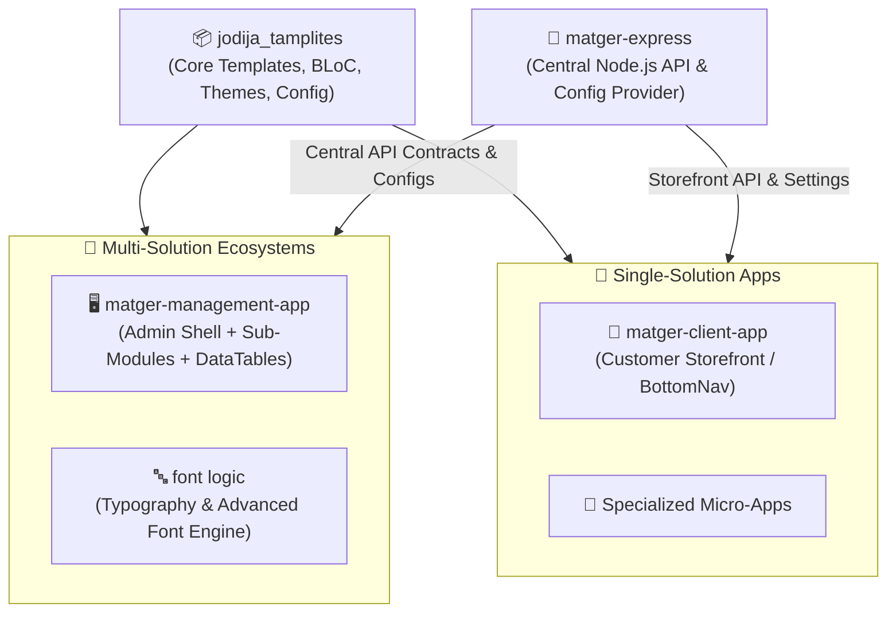

<div align="center">


# 🚀 JoDija Templates (Adaptive App Shell & Enterprise Toolkit)

### *Simplifying Flutter Workflows And Universal Cross-Platform Solutions*

**An advanced, enterprise-grade Flutter package for building responsive dashboards, single-purpose apps, and modular multi-solution ecosystems with built-in native RTL support and adaptive navigation.**

[](pubspec.yaml)
[](https://flutter.dev)
[](https://dart.dev)
[](LICENSE)
[](#2-native-rtl--localization-support)
[](#-documentation-index)

---

### 🌐 Language / اللغة
[🇸🇦 **اقرأ هذا الدليل باللغة العربية (README.ar.md)**](README.ar.md) • [📚 **Full Documentation Portal (doc/README.md)**](doc/README.md)

---

</div>

## 📸 Real UI Showcase

Real-world production applications powered by **JoDija Templates**, such as **Delta Mager Pro**:

<div align="center">
  
  <p><em><strong>Products Dashboard:</strong> RTL collapsible Sidebar with custom Olive Theme, filter chips, responsive card grid, and badges (Best Seller, Hot Discount).</em></p>
</div>

<div align="center">
  
  <p><em><strong>Categories & Catalog Dashboard:</strong> Active sidebar item highlight, quick search bar, and custom styled floating actions.</em></p>
</div>

---

## 🏛️ Architectural Philosophy: Single-Solution vs Multi-Solution

`JoDija Templates` is built upon a unified architecture designed to support both focused micro-apps and expansive enterprise platforms without redundant boilerplate:



1. **Single-Solution Apps:**
   - Designed for single, streamlined workflows (e.g., `matger-client-app` with bottom navigation).
   - Lightweight, highly responsive, and leveraging the shared core utilities, models, and BLoC layer.
2. **Multi-Solution Ecosystems:**
   - Scalable enterprise applications with nested modules, sub-dashboards, and rich reporting (e.g., `matger-management-app` and `font logic`).
   - Powered by `AdaptiveAppShell` which auto-adapts layouts between Desktop, Tablet, and Mobile, coupled with the `Cell Models` engine for dynamic data tables.
3. **Shared Backend Backbone (`matger-express`):**
   - Serves unified data contracts, live remote configuration, and feature flags to all connected platforms.

---

## 🌟 Key Features

### 1. 🧭 Responsive Adaptive App Shell
- **Automatic Layout Switching:** Dynamically transitions between a persistent `Sidebar` on Desktop/Web, and a collapsible `Drawer` or `BottomNavigationBar` on Mobile and Tablets.
- **Advanced Navigation (`GoRouter` Ready):** Native deep linking, nested routing, URL path parameters (`:id`), and query parameters (`?filter=active`).
- **Customizable Top Bar (`AppBarConfig`):** Complete control over app bar titles, actions, back-navigation handlers, and branding.

### 2. 🌍 Native RTL & Arabic Localization
- **First-Class RTL Support:** Built specifically with Arabic and RTL-first layouts in mind. Sidebars, drawers, icons, and animations flip naturally without broken layouts.
- **Dynamic Language Engine (`LocalizationConfig` & `AppLocalizationsInit`):** Instant runtime language switching without restarting the app.
- **Google Fonts Integration:** Pre-configured support for popular Arabic typography such as Cairo, Tajawal, and Almarai.

### 3. 🧩 State Management & Unified Data Layer (`DataSourceBloc`)
- **Standardized State Machine:** `FeaturDataSourceState` providing seamless states: `Initial`, `Loading`, `Loaded`, `Error`, and `Empty`.
- **Pre-Built CRUD Operations:** Extend `BaseBloc` and `CrudBloc` to eliminate repetitive data-fetching, updating, and deletion code.

### 4. 📊 Advanced Cell & Data Table Engine (`Cell Models`)
- **Flexible Data Mapping:** Convert any `BaseViewDataModel` into smart, composable `Cell` and `RowofCells` objects.
- **Table Calculations (`DataTableOfCellModels`):** Built-in methods for extracting unique groups (`unicGrubs`), statistical aggregations (`countBy`), and generating rich tabular views.

### 5. 🎨 Design System & Dynamic Theming
- **Comprehensive Color Palette (`AppColors`):** Unified tokens for primary, secondary, background, surface, and feedback colors.
- **Adaptive Theming (`AppThemes` & `DashboardThemes`):** Full light/dark mode support with specialized themes for admin dashboards (including modern Olive, Dark Slate, and Navy palettes).

### 6. 💾 Local Storage & Session Management
- **Session Helper (`SharedPrefranceData`):** Simplified persistent storage for user profiles, login state, auth tokens, and HTTP headers.
- **Offline SQLite Caching (`sqllite_helper.dart`):** Structured local database support for offline-first capabilities.

### 7. ✅ Form Validation & Input Helpers
- Pre-built validators: `RequiredValidator`, `EmailValidator`, `PasswordValidator`, and `NumberValidator` with multilingual localized error messages.

---

## ⚡ Quick Start

### 1. Installation (via GitHub)

Add `JoDija_tamplites` directly from GitHub to your `pubspec.yaml`:

```yaml
dependencies:
  flutter:
    sdk: flutter
  JoDija_tamplites:
    git:
      url: https://github.com/zeftawyapps/jodija_tamplites.git
      ref: master
```

### 2. Configure Global Settings

Create your configuration class extending `DataViewConfigraion`:

```dart
import 'package:flutter/material.dart';
import 'package:JoDija_tamplites/project_configrations/app_configration.dart';

class MyAppConfig extends DataViewConfigraion {
  @override
  String get AppName => "Delta Mager Pro";

  @override
  Widget launchScreen() => const DashboardScreen();

  @override
  Map<String, Widget> getRouters() => {
    '/dashboard': const DashboardScreen(),
    '/products': const ProductsScreen(),
    '/categories': const CategoriesScreen(),
  };

  @override
  void setAppLocal(String localCode) {
    // Handle dynamic locale change
  }
}
```

### 3. Launch with `AdaptiveAppShell`

```dart
import 'package:flutter/material.dart';
import 'package:JoDija_tamplites/tampletes/screens/routed_contral_panal/laaunser.dart';
import 'package:JoDija_tamplites/tampletes/screens/routed_contral_panal/models/route_item.dart';

void main() {
  runApp(const MyApp());
}

class MyApp extends StatelessWidget {
  const MyApp({super.key});

  @override
  Widget build(BuildContext context) {
    return AdaptiveAppShell(
      titleApp: "Delta Mager Pro",
      initRouter: "/products",
      languageCode: "en", // Set 'ar' for native Arabic / RTL
      isDarkMode: false,
      
      // Custom Sidebar Styling (e.g., Enterprise Olive Theme)
      sidebarBackgroundColor: const Color(0xFF556B2F),
      sidebarSelectedColor: Colors.white,
      sidebarTextColor: Colors.white,
      sidebarSelectedTextColor: const Color(0xFF556B2F),
      
      sidebarItems: [
        RouteItem(
          id: "dashboard",
          path: "/dashboard",
          label: "Dashboard",
          icon: Icons.dashboard_outlined,
          content: const DashboardScreen(),
          isSideBarRouted: true,
          isAppBar: true,
        ),
        RouteItem(
          id: "products",
          path: "/products",
          label: "Products",
          icon: Icons.inventory_2_outlined,
          content: const ProductsScreen(),
          isSideBarRouted: true,
          isAppBar: true,
        ),
        RouteItem(
          id: "categories",
          path: "/categories",
          label: "Categories",
          icon: Icons.category_outlined,
          content: const CategoriesScreen(),
          isSideBarRouted: true,
          isAppBar: true,
        ),
      ],
    );
  }
}
```

---

## 📚 Documentation Index

| Guide | Description | Link |
| :--- | :--- | :--- |
| **🇸🇦 Arabic Guide** | Complete package guide and documentation in Arabic | [README.ar.md](README.ar.md) |
| **🚀 End-to-End Tutorial** | Complete step-by-step developer tutorial from zero to production | [HOW_TO_USE.md](doc/HOW_TO_USE.md) |
| **Philosophy & Architecture** | Single vs Multi-Solution patterns and backend integration | [PHILOSOPHY_AND_ARCHITECTURE.md](doc/01_architecture/PHILOSOPHY_AND_ARCHITECTURE.md) |
| **Configuration Guide** | Comprehensive guide to `DataViewConfigraion` and `AppHttpConnector` | [CONFIGURATION_GUIDE.md](doc/01_architecture/CONFIGURATION_GUIDE.md) |
| **Adaptive App Shell** | Layout templates, themes, sidebar customization, and animations | [ADAPTIVE_APP_SHELL_GUIDE.md](doc/02_templates/ADAPTIVE_APP_SHELL_GUIDE.md) |
| **Shared Utilities** | BLoC state management, Cell Models, local storage, and validators | [SHARED_UTILS_GUIDE.md](doc/03_utils/SHARED_UTILS_GUIDE.md) |
| **Ecosystem Integration** | Integrating management dashboards, client apps, and express API | [MATGER_ECOSYSTEM_INTEGRATION.md](doc/04_integrations/MATGER_ECOSYSTEM_INTEGRATION.md) |
| **📖 Complete API Catalog** | Comprehensive module-by-module reference catalog of all classes | [API_REFERENCE.md](doc/API_REFERENCE.md) |

---

## 📄 License

This project is licensed under the MIT License - see the [LICENSE](LICENSE) file for details.
