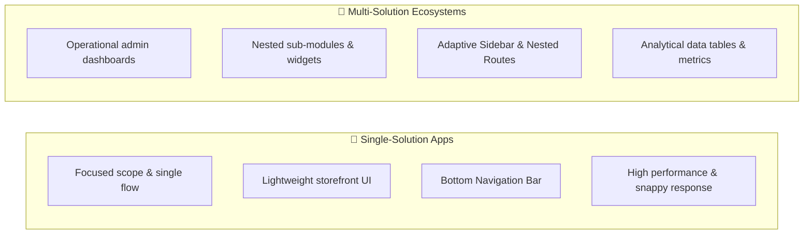
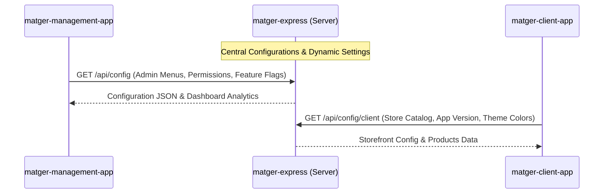

# 🏛️ Architectural Philosophy: Single-Solution vs Multi-Solution
### *Simplifying Flutter Workflows And Universal Cross-Platform Solutions*

---

### 🌐 Language / اللغة
[🇸🇦 **النسخة العربية (PHILOSOPHY_AND_ARCHITECTURE.ar.md)**](PHILOSOPHY_AND_ARCHITECTURE.ar.md) • [📚 **Documentation Index (README.md)**](../README.md)

---

## 1. Introduction & Foundational Origins
From the initial inception of **JoDija Templates**, the vision was not merely to assemble a standard UI template, but rather to construct a resilient **Architectural Framework** capable of serving two distinct application paradigms while maintaining a 100% shared, DRY (Don't Repeat Yourself) codebase.

---

## 2. Core Architectural Comparison

### 1. Single-Solution Applications
- **Definition:** Applications crafted to perform a focused task or serve end-users prioritizing speed and intuitive simplicity.
- **Representative Implementation:** `matger-client-app` (customer shopping app).
- **Architectural Characteristics:**
  - Streamlined bottom navigation (`isInBottomNavBar = true`).
  - Isolated checkout flow (browse, cart, checkout) avoiding admin sidebar complexity.
  - Shared data layer (`DataSourceBloc`) and HTTP client (`AppHttpConnector`) to access the same catalog and orders without duplication.

### 2. Multi-Solution Modular Ecosystems
- **Definition:** Comprehensive platforms housing multiple operational tools and suites within a unified runtime.
- **Representative Implementations:**
  - **`font logic`:** Advanced typography management, font manipulation, and rendering suite.
  - **`matger-management-app`:** Comprehensive enterprise store management (catalog, inventory, order processing, and financial reporting).
- **Architectural Characteristics:**
  - Relies on `AdaptiveAppShell` for a persistent `Sidebar` on Desktop/Tablet and a responsive `Drawer` on Mobile.
  - Multi-tier nested routing with group-based navigation.
  - Uses `DataTableOfCellModels` for high-density dataset processing, calculation, and advanced reporting.

---

## 3. Central Role of `matger-express`

The **`matger-express`** Node.js/Express backend serves as the unified backbone connecting both app paradigms:

1. **Shared Data Contracts:**
   - Server response payloads map directly to Flutter's `BaseViewDataModel`.
2. **Dynamic Live Configuration:**
   - Real-time deployment of localization maps, brand colors, and app version enforcement directly from the server.
3. **Feature Flags:**
   - Instant activation or deactivation of specific modules in `matger-management-app` or `matger-client-app` without re-releasing binary builds to app stores.
