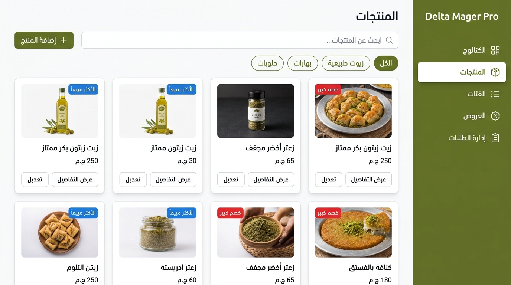
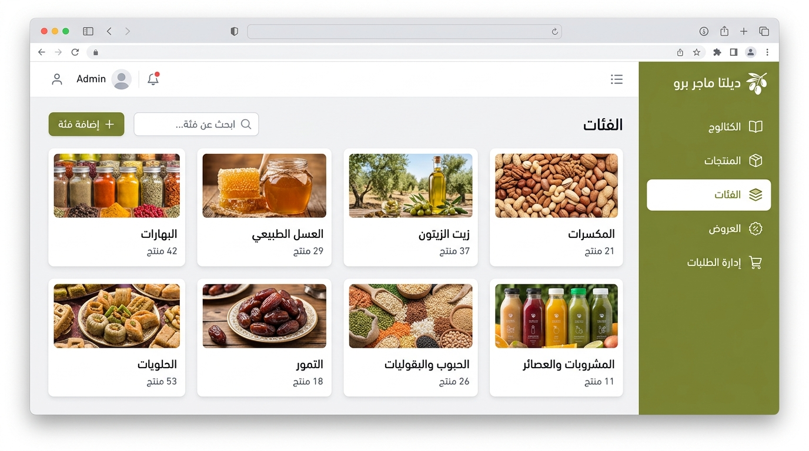

# 🧭 Adaptive App Shell Comprehensive Guide

---

### 🌐 Language / اللغة
[🇸🇦 **النسخة العربية (ADAPTIVE_APP_SHELL_GUIDE.ar.md)**](ADAPTIVE_APP_SHELL_GUIDE.ar.md) • [📚 **Documentation Index (README.md)**](../README.md)

---

## 1. Overview
**`AdaptiveAppShell`** is the core component for constructing cross-platform, responsive interfaces that automatically adapt across Desktop, Web, Tablet, and Mobile screen viewports. It features native, first-class **RTL** and Arabic localization alongside micro-animations and route synchronizers.

---

## 2. Real Visual Showcase

<div align="center">
  
  
</div>

---

## 3. Key Parameters & Configuration Properties

| Property | Type | Description |
| :--- | :--- | :--- |
| `sidebarItems` | `List<RouteItem>` | List of navigation route items, icons, and destinations |
| `languageCode` | `String` | Active locale code ('ar' auto-activates native RTL, 'en' enables LTR) |
| `isDarkMode` | `bool` | Toggles between light and dark theme modes |
| `sidebarBackgroundColor` | `Color?` | Custom sidebar background color (e.g., Olive theme `0xFF556B2F`) |
| `sidebarSelectedColor` | `Color?` | Highlight background color for active route items |
| `sidebarTextColor` | `Color?` | Normal font color for unselected navigation items |
| `sidebarSelectedTextColor` | `Color?` | Font color for active route items |
| `animationType` | `SidBarAnimationType` | Entrance animation curve (`slideAndFade`, `fadeOnly`, etc.) |
| `smallScreenAppBar` | `AppBarConfig?` | Mobile view top app bar configuration |
| `largeScreenAppBar` | `AppBarConfig?` | Desktop/Tablet view top app bar configuration |
| `extraProvidersAndBlocs` | `List<SingleChildWidget>?` | Global dependency injection layer for BLoCs and Providers |

---

## 4. The `RouteItem` Data Model

Defines routing endpoints and behavior within the application shell:

```dart
RouteItem(
  id: "products",
  path: "/products",
  label: "Products",
  icon: Icons.inventory_2_outlined,
  content: const ProductsScreen(),
  isSideBarRouted: true,    // Enables URL-based synchronization
  isAppBar: true,           // Renders top app bar
  isInBottomNavBar: false,  // Controls inclusion in mobile bottom nav bar
  isVisableInSideBar: true, // Visible in desktop sidebar
)
```

---

## 5. Navigation Features via `AppShellRouterMixin`

Any screen mixing with `AppShellRouterMixin` gains direct access to route parameters and navigation helpers:

```dart
class ProductDetailsScreen extends StatefulWidget {
  const ProductDetailsScreen({super.key});

  @override
  State<ProductDetailsScreen> createState() => _ProductDetailsScreenState();
}

class _ProductDetailsScreenState extends State<ProductDetailsScreen>
    with AppShellRouterMixin {
  
  @override
  void initState() {
    super.initState();
    // Directly retrieve the :id URL route parameter
    final productId = getPrams()?['id'];
  }

  @override
  Widget build(BuildContext context) {
    return Scaffold(
      body: ElevatedButton(
        onPressed: () => goRoute(context, '/categories'),
        child: const Text('Back to Categories'),
      ),
    );
  }
}
```
