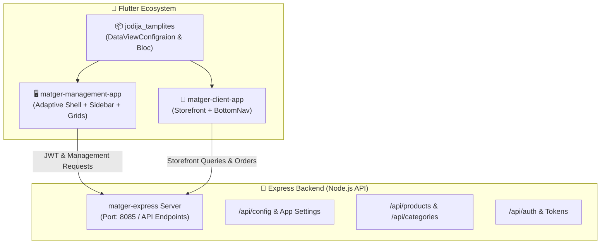

<div align="center">


# 🔗 Matger Ecosystem Integration Guide
### *Simplifying Flutter Workflows And Universal Cross-Platform Solutions*

---

### 🌐 Language / اللغة
[🇸🇦 **النسخة العربية (MATGER_ECOSYSTEM_INTEGRATION.ar.md)**](MATGER_ECOSYSTEM_INTEGRATION.ar.md) • [📚 **Documentation Index (README.md)**](../README.md)

---

</div>

This comprehensive guide details the full integration between the three key ecosystem components:
1. **`matger-management-app`** (administrative dashboard & operational control panel).
2. **`matger-client-app`** (customer shopping storefront).
3. **`matger-express`** (central Node.js REST backend).

---

## 1. Architecture & Communication Workflow



---

## 2. Integration with `matger-management-app` (Admin Panel)

### Configuration Setup:
```dart
class MatgerManagementConfig extends DataViewConfigraion {
  @override
  String get AppName => "Delta Mager Pro - Control Panel";

  @override
  String get AppNameID => "delta_mager_admin";

  @override
  Widget launchScreen() => const ProductsManagementScreen();

  @override
  Map<String, Widget> getRouters() => {
    '/dashboard': const AnalyticsScreen(),
    '/products': const ProductsManagementScreen(),
    '/categories': const CategoriesManagementScreen(),
    '/orders': const OrdersManagementScreen(),
  };

  @override
  void setAppLocal(String localCode) {
    // Dynamic RTL activation and locale update
  }
}
```

### Leveraging `AdaptiveAppShell`:
- Configure `sidebarBackgroundColor: const Color(0xFF556B2F)` (Olive enterprise theme for administrative dashboards).
- Enable desktop persistent sidebars and deep-linked admin routes.

---

## 3. Integration with `matger-client-app` (Storefront)

### Configuration Setup:
```dart
class MatgerClientConfig extends DataViewConfigraion {
  @override
  String get AppName => "Delta Store";

  @override
  String get AppNameID => "delta_store_client";

  @override
  Widget launchScreen() => const StorefrontHomeScreen();

  @override
  Map<String, Widget> getRouters() => {
    '/': const StorefrontHomeScreen(),
    '/category/:id': const CategoryProductsScreen(),
    '/cart': const CartScreen(),
    '/profile': const UserProfileScreen(),
  };

  @override
  void setAppLocal(String localCode) {}
}
```

### Storefront Customizations:
- Enable `isInBottomNavBar: true` on top-level routes for mobile thumb-friendly shopping.
- Suppress desktop management sidebars for a focused consumer experience.

---

## 4. Connecting with `matger-express` (Backend Engine)

### Shared API Contracts:
- **Configuration Endpoint:** `GET /api/config`
  - Returns global shop settings, default currency (`EGP`), activated languages, and live feature flags.
- **Products & Categories Endpoints:**
  - `GET /api/products` (supports filter query parameters: `category`, `search`, `page`, `limit`).
  - `GET /api/categories` (returns category trees, product counts, and cover images).
- **Authentication:**
  - Securely store and transmit Bearer JWT tokens via `SharedPrefranceData`.
